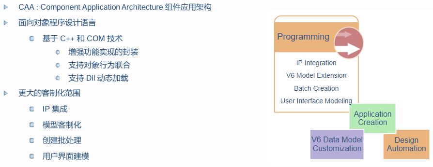
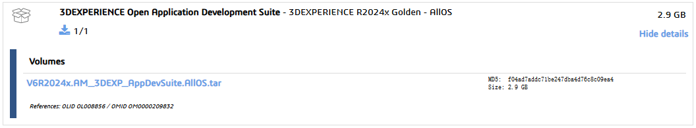
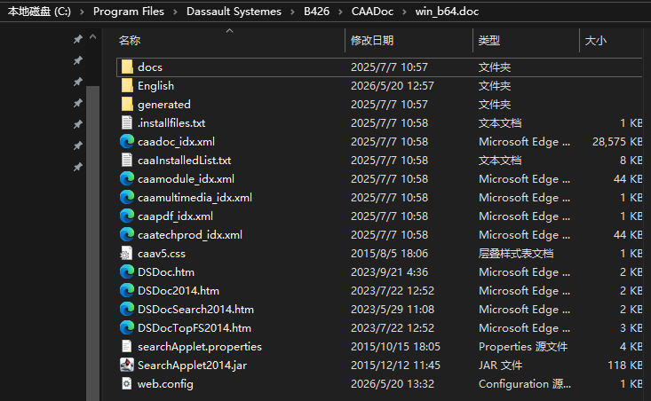
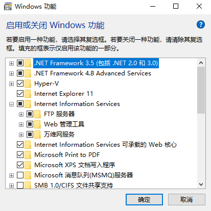
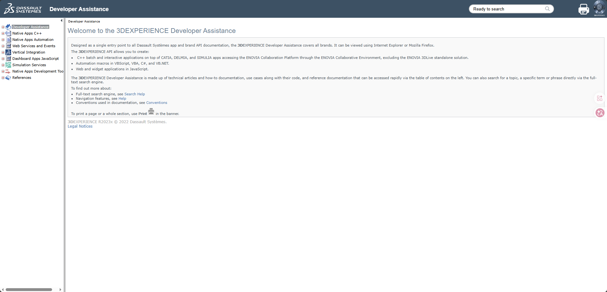
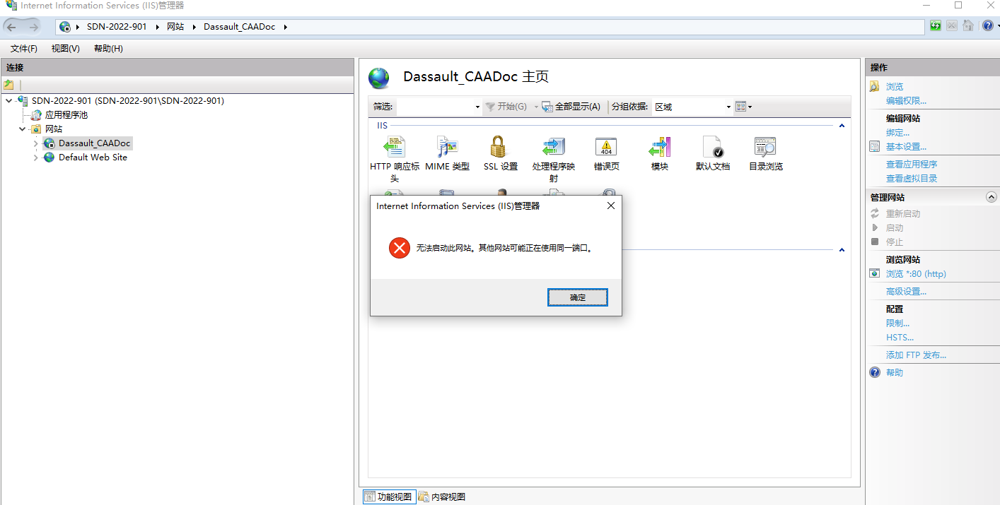
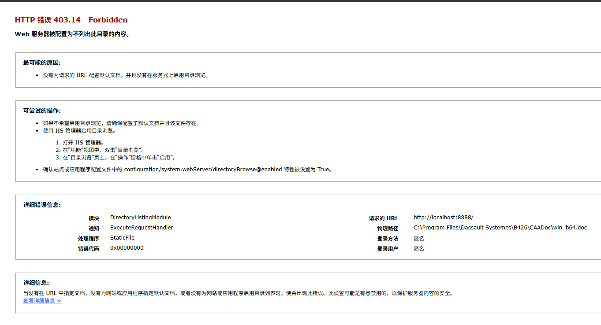

# CAA开发-搭建帮助文档环境

2026-05-21

# WHAT IS CAA?

# 1	开发帮助文档
学习开发的第一步就是安装开发帮助文档，俗称百科全书。
## 1.1	安装介质
**3DEXPERIENCE Open Application Development Suite** - 3DEXPERIENCE R2024x Golden - AllOS

在客户端的基础上继续安装，安装后默认路径为：

## 1.2	Internet Information Services (lIS)管理器添加网站
### 1.2.1	开通IIS
如果没有开通IIS，那就需要如下操作
- 先确认 IIS 已经开启：按 `Win+R` → 输入 `optionalfeatures` → 回车，在「Windows 功能」里找到 **Internet Information Services**，确保勾选了这些核心组件：
    
    - Web 管理工具 → IIS 管理控制台
    - 万维网服务 → 静态内容、默认文档、目录浏览、HTTP 错误
    - （可选）CGI/ISAPI 扩展（如果文档用到 Java Applet，需要确认是否启用）
    
- 安装完成后，按 `Win+R` 输入 `inetmgr` 回车，打开 **IIS 管理器**。

### 1.2.2	新建 IIS 网站
- 在 IIS 管理器左侧「网站」节点上，右键 → **添加网站**
- 按如下填写配置：

| 配置项   | 填写内容                                                      |
| ----- | --------------------------------------------------------- |
| 网站名称  | Dassault_CAADoc（自定义，方便识别）                                 |
| 物理路径  | C:\Program Files\Dassault Systems\B426\CAADoc\win_b64.doc |
| 绑定类型  | http                                                      |
| IP 地址 | 全部未分配                                                     |
| 端口    | 自定义一个未被占用的端口（比如 `8080`，避免和默认 80 端口冲突）                     |

- 点击「确定」，完成网站创建。
### 1.2.3	关键配置：解决权限与文档访问
#### 1.2.3.1	1. 目录权限配置

1. 右键你的 `win_b64.doc` 文件夹 → 属性 → 安全 → 编辑
2. 添加用户：`IIS AppPool\DefaultAppPool`（或你刚才新建网站对应的应用程序池用户），实际显示只有一个IIS开头`IIS_IUSRS`用户
3. 给这个用户授予 **读取 & 读取和执行** 权限，点击「确定」保存。
	
#### 1.2.3.2	2. 默认文档设置（让 IIS 识别首页）

1. 在 IIS 管理器中，选中你的 `Dassault_CAADoc` 网站
2. 双击打开右侧的「默认文档」功能
3. 点击「添加」，输入首页文件名：`DSDoc.htm`（这是你目录里的入口文件）
4. 把 `DSDoc.htm` 上移到列表最顶端，确保 IIS 优先识别它。
## 1.3	浏览网站

后期可以通过网址进入
### 1.3.1	可能报错
- 端口被占用

修改端口即可

- 没有添加首页，报错403.14

目录里有入口文件 `DSDoc.htm`，把它设为默认文档即可：

1. 在 IIS 管理器中选中 `Dassault_CAADoc` 网站，双击打开「默认文档」功能。
2. 点击「添加」，输入文件名：`DSDoc.htm`，点击确定。
3. 选中刚添加的 `DSDoc.htm`，点击「上移」按钮，把它排到列表的最顶端。
4. 保存设置后，重启网站，再访问 `http://localhost:8888/`，就会自动打开 `DSDoc.htm` 了。
### 1.3.2	汉化阅读
目前方案：Edge浏览器加沉浸式翻译插件

